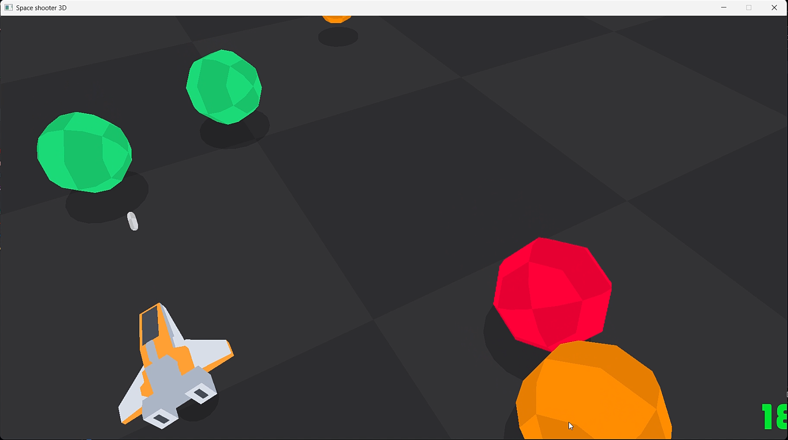

# 🚀 Space Shooter Game 3D

A simple 3D space-shooting game built using **Python** and **raylib**. Move your player, shoot bullets, and destroy meteors!

## 📸 Screenshot



## 🎮 Gameplay

- Move the player left and right.
- Shoot bullets at meteors.
- Destroy meteors when bullets hit them.

## 🕹️ Controls

| Key | Action |
|---|---|
| `←` Left Arrow | Move left |
| `→` Right Arrow | Move right |
| `Spacebar` | Shoot bullets |

## ✨ Features

- 3D graphics using raylib.
- Keyboard-controlled player movement.
- Bullet-shooting mechanics.
- Meteor destruction using collision detection.

## 🛠️ Built With

- **Python**
- **raylib**

## 📋 Requirements

- Python 3
- Git
- Dependencies listed in `requirements.txt`

## 🚀 Installation and Setup

### 1. Clone the repository

```bash
git clone https://github.com/Pavan-Adapa/Space-Shooter_Game-3D.git
```

### 2. Navigate to the project directory

```bash
cd Space-Shooter_Game-3D
```

### 3. Create a virtual environment

```bash
python -m venv .venv
```

Activate the environment on Windows:

**Command Prompt:**

```bat
.venv\Scripts\activate
```

**PowerShell:**

```powershell
.\.venv\Scripts\Activate.ps1
```

### 4. Install dependencies

```bash
pip install -r requirements.txt
```

### 5. Run the game

```bash
python main.py
```

Replace `main.py` with the actual entry-point filename if your project uses a different one.

## 📁 Project Structure

```text
Space-Shooter_Game-3D/
├── audio/              # Sound effects and audio assets
├── shaders/            # Shader programs
├── code/               # Game source code
├── font/               # Font assets
├── models/              # 3D models
├── textures/            # Textures used in the game
├── screenshots/
│   └── app.png          # Gameplay screenshot
├── requirements.txt     # Python dependencies
└── README.md            # Project documentation

## 🎯 Objective

Aim carefully, shoot bullets with the Spacebar, and destroy meteors to clear your way through space.

## 🔮 Future Improvements

- Score tracking.
- Multiple meteor types.
- Increasing difficulty.
- Sound effects and background music.
- Player health and lives.
- Game-over and restart screens.

## 👨‍💻 Author

**Pavan Adapa**

GitHub: [@Pavan-Adapa](https://github.com/Pavan-Adapa)

## ⭐ Support

If you like this project, consider giving the repository a star!

[View Space-Shooter_Game-3D on GitHub](https://github.com/Pavan-Adapa/Space-Shooter_Game-3D)
